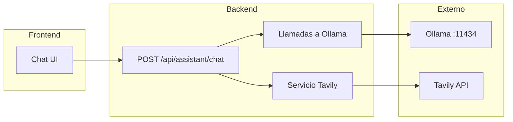

# Plan: Asistente IA con Ollama y búsqueda web

## Decisiones fijadas

- **LLM:** Ollama (local). Tokens efectivamente ilimitados; límite lo marca el hardware del servidor/PC donde corre Ollama.
- **Búsqueda web:** Tavily. Encaja con ~10 usuarios (1.000 créditos/mes gratis) y es estable para integrar en el flujo del chat.
- **Modelo recomendado:** Llama 3.1 8B (alternativa: Qwen2.5 7B), dado el hardware disponible.

---

## Requisitos de PC y modelo

### Hardware del proyecto: 16 GB RAM

Con **16 GB de RAM**:

- **Llama 3.1 8B** y **Qwen2.5 7B** son adecuados y caben sin problema.
- **Solo CPU (sin GPU):** el modelo corre en RAM; las respuestas pueden tardar **20–60 segundos** según longitud y CPU. Válido para uso personal o pocos usuarios.
- **Con GPU (6–8 GB VRAM):** Ollama usará la GPU; respuestas en **pocos segundos**. Los 16 GB de RAM siguen siendo suficientes.
- **No usar en este equipo:** variantes 70B o 32B (quedan cortos de memoria).

### Requisitos concretos para Llama 3.1 8B

| Componente | Mínimo | Recomendado (16 GB RAM) |
|------------|--------|--------------------------|
| RAM | 8 GB | 16 GB (tu caso) |
| VRAM (GPU) | — | 6–8 GB si se quiere velocidad |
| Disco | ~5 GB | ~5 GB |
| CPU | 4+ núcleos | Cualquier CPU moderna |

---

## Por qué Tavily para ~10 usuarios

- **Límite gratis:** 1.000 créditos/mes (sin tarjeta). 1 búsqueda "basic" = 1 crédito.
- **Diseñado para IA:** respuestas pensadas para inyectar en LLMs (snippets, fuentes).
- **API simple:** un POST con `query`; fácil de llamar desde Node con `fetch`.
- **Alternativa si se pasa de 1.000/mes:** Brave Search API (~1.000 búsquedas/mes con $5 de crédito).

---

## Stack del asistente

| Componente | Elección |
|------------|----------|
| Modelo / API | Ollama (Llama 3.1 8B por defecto) |
| Búsqueda web | Tavily (`TAVILY_API_KEY`) |
| Razonamiento | Llama 3.1 8B + system prompt "paso a paso" si se desea |
| UI | Nueva página "Asistente" en el sidebar (y en "Más" en móvil) |

---

## Arquitectura de flujo

- Usuario escribe en el chat y puede activar "Incluir búsqueda web".
- Backend: si `useWebSearch`, llama a Tavily, obtiene N resultados (p. ej. 5–8), formatea titulares + snippets y los inyecta en el contexto que se envía a Ollama.
- Ollama devuelve la respuesta; opcionalmente streaming para mejor UX.

---

## Implementación técnica (resumida)

- **Backend** ([backend/src/index.ts](backend/src/index.ts))
  - Dependencia: `ollama` (npm). Variable: `OLLAMA_HOST` (por defecto `http://localhost:11434`).
  - Ruta `POST /api/assistant/chat` con `requireAuth`. Body: `{ messages: Array<{role, content}>, useWebSearch?: boolean }`.
  - Modelo por defecto: `llama3.1:8b` (configurable por env si se quiere).
  - Si `useWebSearch`: llamar a Tavily con `TAVILY_API_KEY`, inyectar resultados en el contexto antes de llamar a Ollama.
  - Opcional: respuesta en streaming.

- **Frontend**
  - Nueva página "Asistente" (`activePage === 'assistant'`), componente de chat (lista de mensajes + input + toggle "Incluir búsqueda web"). Llamada a `POST /api/assistant/chat` con `API_BASE` y `parseResponse`.

- **Entorno**
  - `OLLAMA_HOST`: opcional; URL de Ollama.
  - `TAVILY_API_KEY`: necesario para búsqueda web.

---

## Orden de implementación

1. Backend: cliente Ollama y `POST /api/assistant/chat` sin búsqueda (solo historial de mensajes), modelo `llama3.1:8b`.
2. Frontend: página "Asistente" y UI de chat básica.
3. Backend: servicio Tavily e integración en la ruta cuando `useWebSearch === true`.
4. Frontend: toggle "Incluir búsqueda web" y, si se añade, streaming de respuesta.
5. Opcional: historial persistido (Prisma) y/o botón flotante que abra el mismo chat.
